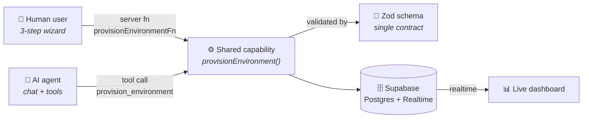
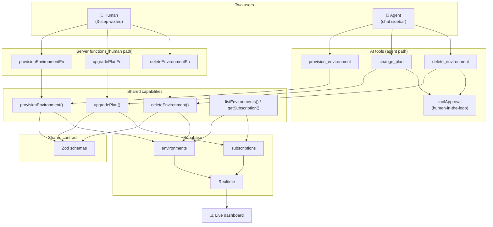

# Architecture — "One capability, two clients"

This is the diagram to put on your **money-shot slide** (slide 8). It shows the entire thesis in one picture: a human and an AI agent are two different interfaces to the **same** capability, validated by the **same** contract, writing to the **same** store.

## The core diagram (Mermaid — renders on GitHub)



## ASCII version (for slides / terminal)

```
        👤 Human user                  🤖 AI agent
      (3-step wizard)             (chat sidebar + tools)
             │                            │
             │ provisionEnvironmentFn     │ provision_environment (tool)
             │                            │
             └────────────┬───────────────┘
                          ▼
             ⚙️ Shared capability: provisionEnvironment()
             (validated by ONE Zod schema)
                          │
                          ▼
             🗄️ Supabase (Postgres + Realtime)
                          │
                          ▼
             📊 Live dashboard (updates in realtime)
```

## The full diagram (all capabilities)



## File map (what lives where)

| Concern | File |
|---------|------|
| Shared contract (Zod) | `src/lib/schemas.ts` |
| Shared capabilities (one source of truth) | `src/server/capabilities.ts` |
| Human entry points (server fns) | `src/server/capabilities.ts` (bottom) |
| Agent entry points (tools + approval) | `src/routes/api/chat.ts` |
| Human wizard | `src/routes/new/step-1/2/3.tsx` |
| Agent chat UI + approval UI | `src/routes/__root.tsx` |
| Live dashboard (realtime) | `src/routes/index.tsx` |
| Browser realtime client | `src/lib/supabase-browser.ts` |
| Server admin client | `src/server/supabase.ts` |
| Schema + realtime + RLS | `supabase/migrations/0001_init.sql` |

## Why this matters (the 3 talking points)

1. **One function, two clients** — the wizard's server function and the AI tool both call `provisionEnvironment()`. No divergence possible.
2. **One contract** — the same Zod schema validates the human form AND the model's tool input. TypeScript type safety for humans, runtime validation for agents.
3. **One source of truth** — both write to the same Supabase tables, and the dashboard reflects both in realtime.
